# Instalar rumbo en la app de escritorio de Claude

Seis pasos, unos cinco minutos, sin terminal. Se hace una sola vez: después rumbo queda disponible en todas tus carpetas.

Lo que hay que tocar está marcado en naranja. Las capturas son de la app en Mac.

## 1. Abrí los plugins

En la barra de la izquierda, entrá a **Personalización**. Arriba, elegí **Plugins** y tocá **Agregar**.

Si en la barra no está **Personalización**, estás en Code: tocá el ícono del globo de diálogo, arriba a la izquierda, al lado de `</>`.

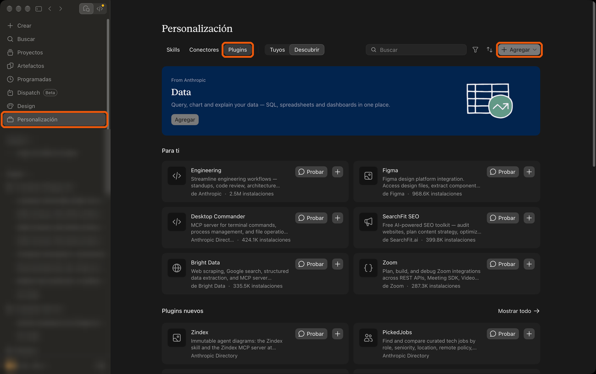

## 2. Sumá el catálogo de rumbo

En el menú que se abre, elegí **Agregar marketplace**.

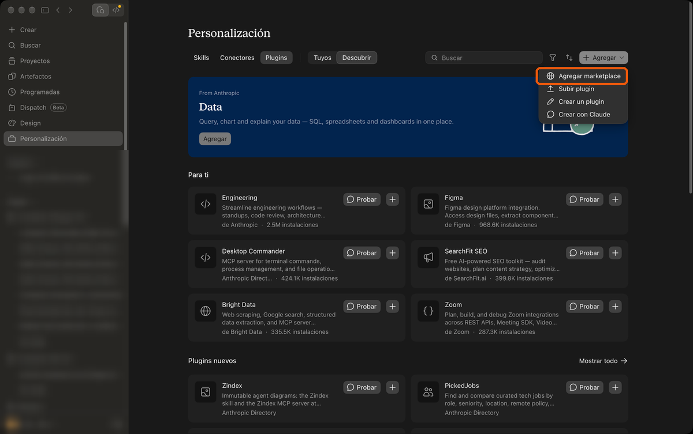

Después, **Agregar desde un repositorio**.

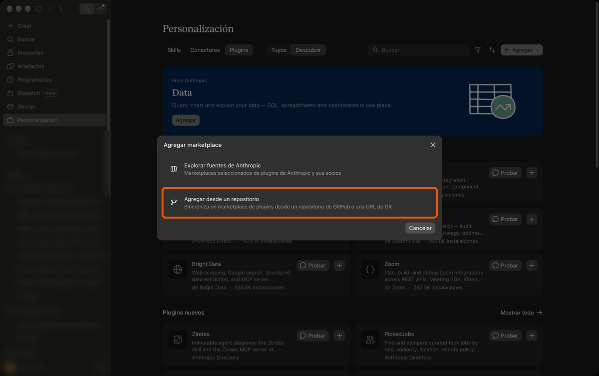

En el campo, pegá esto y apretá Enter:

```
LeopoldoBini/brujula
```

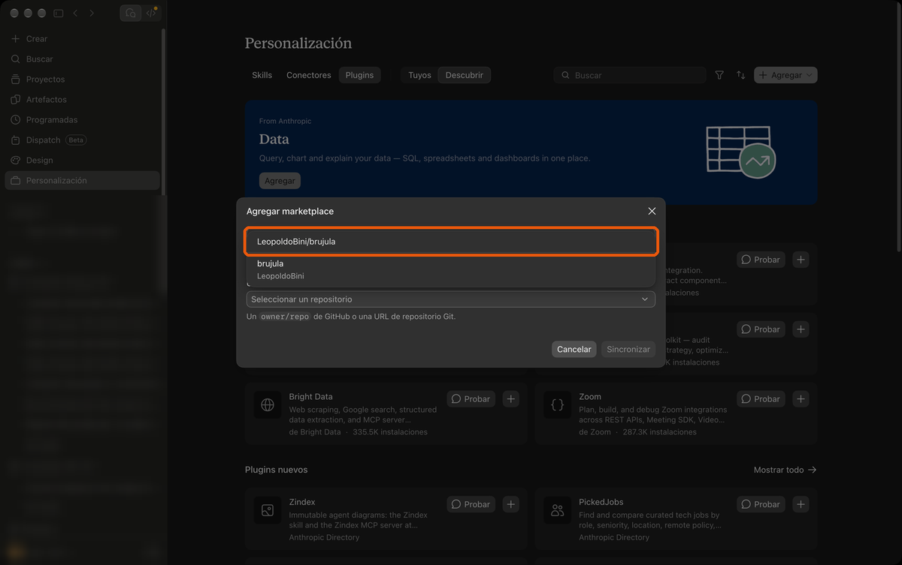

Abajo tiene que decir "Se agregará https://github.com/LeopoldoBini/brujula". Tocá **Sincronizar**.

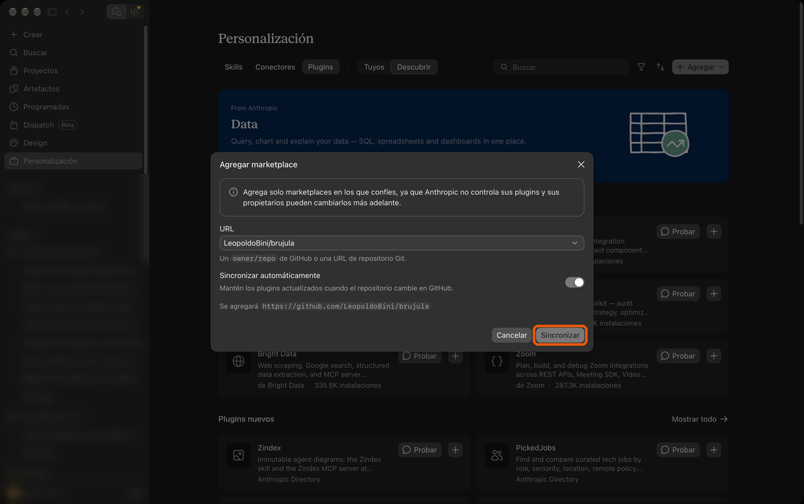

## 3. Buscá Rumbo

Si aparece "No hay nada nuevo para agregar desde esta fuente por ahora", es normal: tocá **Descubrir**.

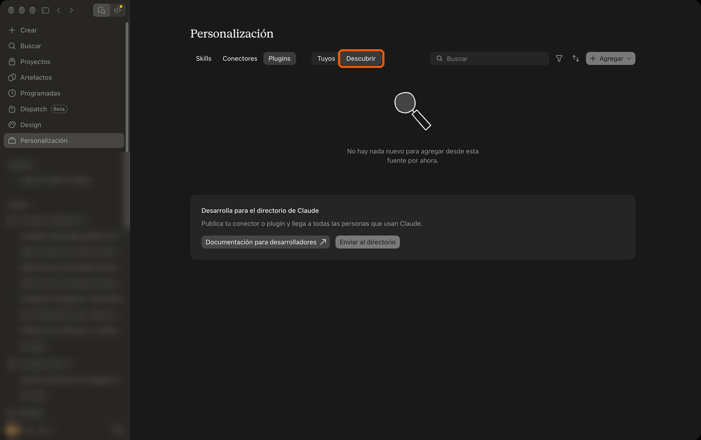

Rumbo está en **Plugins nuevos**, más abajo en la página. Tocá su nombre para abrirlo.

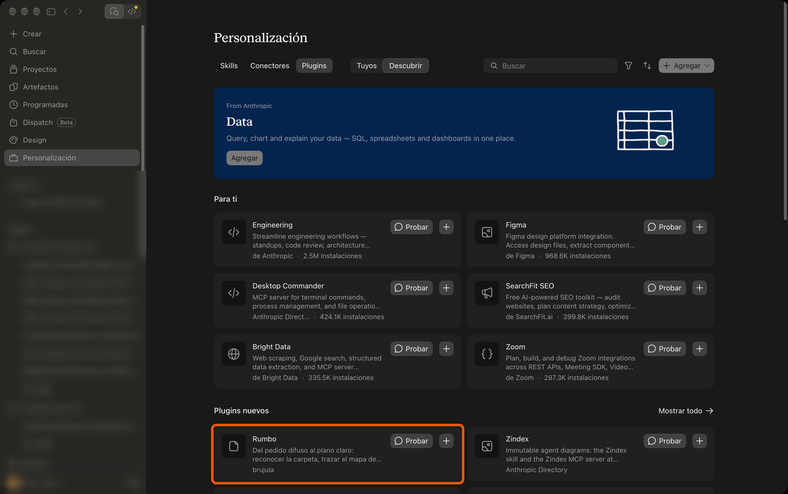

## 4. Agregalo

Tocá **Agregar**.

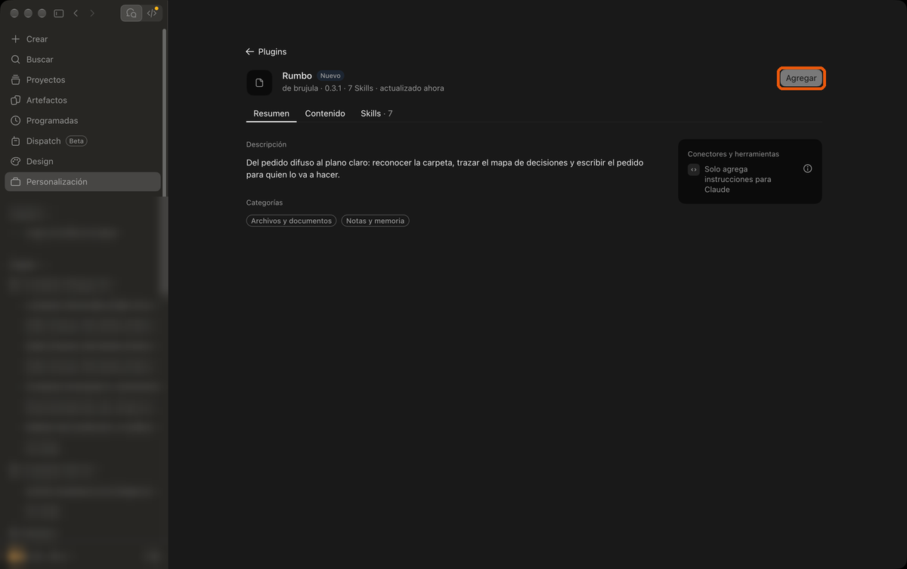

La app avisa "Rumbo está instalado y listo para usar" y el interruptor queda prendido.

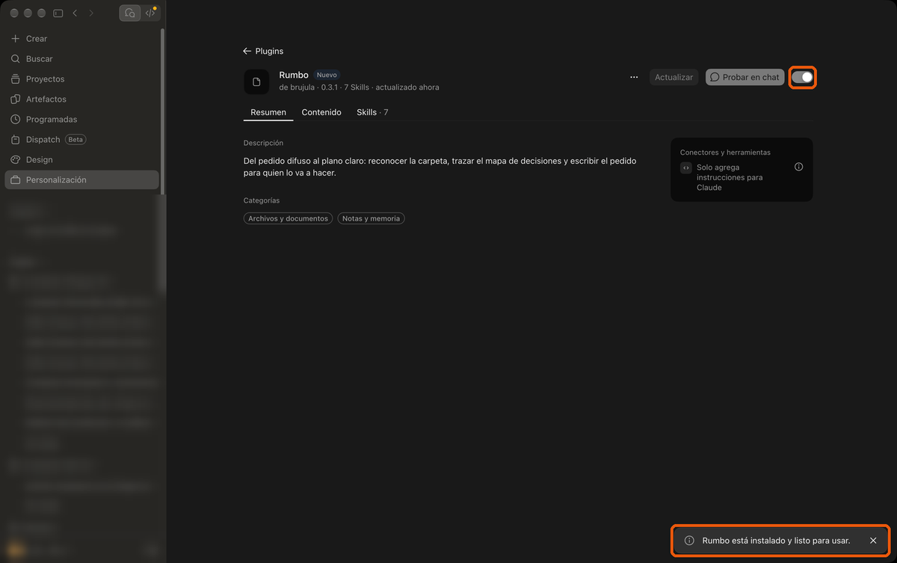

## 5. Abrí una sesión en Code

Arriba a la izquierda, pasá a **Code** (el ícono `</>`). Abajo del cuadro de texto, tocá **Elige una carpeta** y elegí la carpeta donde trabajás: ahí queda su nombre.

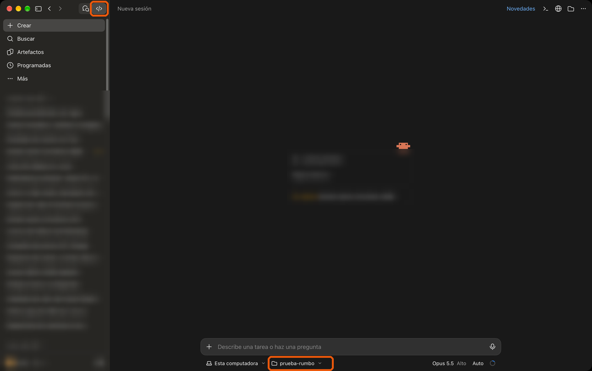

## 6. Corré preparar

Escribí `/rumbo:preparar` completo y apretá Enter dos veces: la primera lo elige de la lista, la segunda lo manda. Con solo `/rumbo` aparecen los siete comandos y el primero ya viene marcado: un Enter apurado elige ese, que no es preparar.

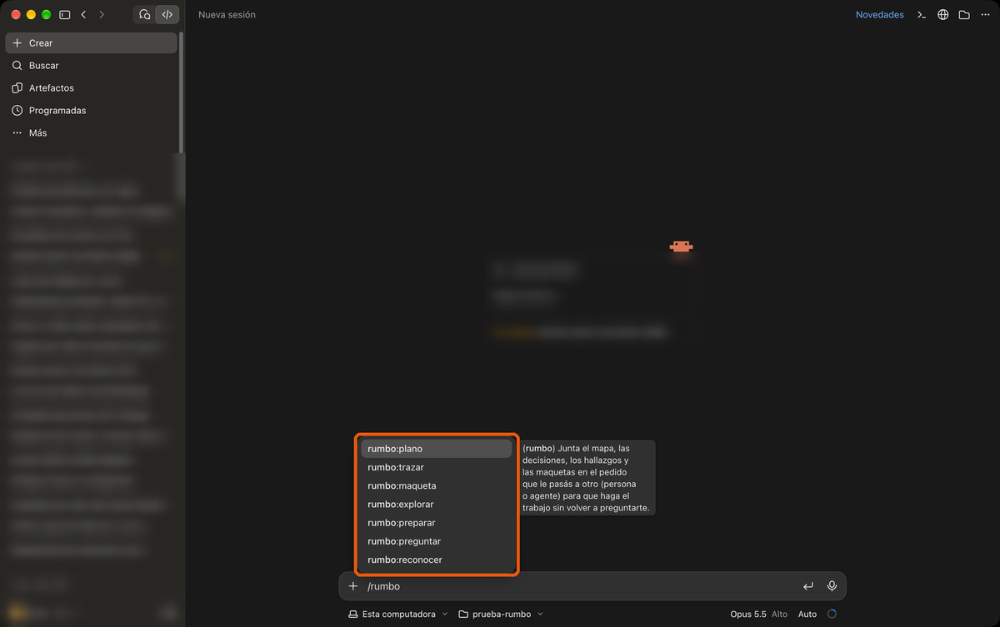

preparar mira lo que ya tenés instalado. Tarda un minuto. Si la app te pide permiso para correr un comando, aceptalo: hasta que contestes sus preguntas, solo mira.

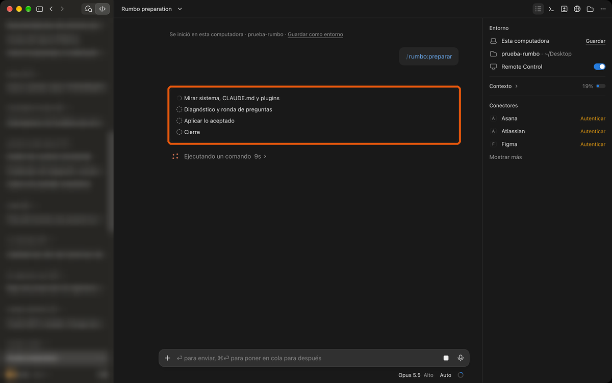

Después te hace unas preguntas, cada una con su respuesta recomendada: si sacar alguna herramienta que choca con rumbo, y si le deja escrito a tu Claude cuándo sugerirte cada comando. Contestá todas en un mensaje, por ejemplo `1 sí, 2 no, 3 sí`. No cambia nada que no hayas aceptado.

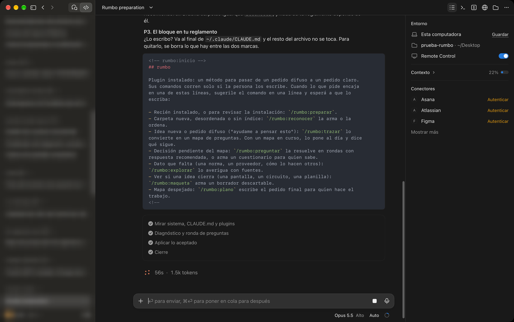

## Listo

El siguiente paso: una sesión nueva en Code sobre tu carpeta de trabajo (la nueva ya toma lo que dejó preparar), y `/rumbo:reconocer`.

## Si algo no sale

| Si ves | Hacé |
|---|---|
| "Este marketplace ya está agregado" | Ya lo tenías: seguí desde el paso 3. |
| Rumbo no está en Descubrir | Esperá unos segundos y volvé a tocar **Descubrir**. |
| `/rumbo` no muestra los comandos | La sesión estaba abierta desde antes de instalar: abrí una sesión nueva en Code. |
